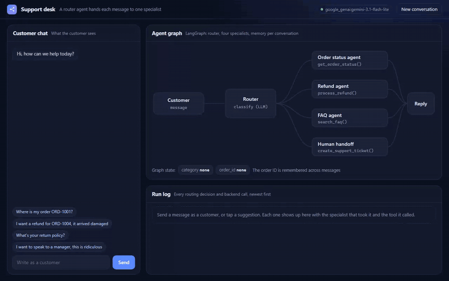

<h1>Multi-Agent Customer Support</h1>

<b>A router reads every customer message and hands it to the specialist built for that job: orders, refunds, FAQs or a human.</b>

  
  
  
  
  

  <a href="#what-it-does">What it does</a> &nbsp;|&nbsp;
  <a href="#how-it-works">How it works</a> &nbsp;|&nbsp;
  <a href="#sample-run">Sample run</a> &nbsp;|&nbsp;
  <a href="#quick-start">Quick start</a> &nbsp;|&nbsp;
  <a href="#configuration">Configuration</a> &nbsp;|&nbsp;
  <a href="#roadmap">Roadmap</a>

 

<h2>See it in action</h2>

Recorded in the built-in support desk from a real run on Google Gemini (<code>gemini-3.1-flash-lite</code>) on 14 November 2026. Nothing is scripted. Only the time spent waiting for the model is fast-forwarded, and the real response times are shown on screen. <a href="demo/demo.mp4">Download the MP4</a>.

Run <code>python app.py</code> and it opens a support desk with the customer chat, a live agent graph that lights up the specialist the router picked, and a log of every tool call. It is the same agent code as the command line version, with a screen on top.

<h2>The problem</h2>

One big support prompt handles simple questions fine and falls apart on refunds. It invents a policy, approves something it shouldn't, and never tells you it wasn't sure.

Businesses need an assistant that is helpful on routine questions and strict where money or policy is involved.

<h2>What it does</h2>

<table>
  <tr><th align="left">Capability</th><th align="left">What that means in practice</th></tr>
  <tr><td><b>Smart routing</b></td><td>A classifier agent reads each message and sends it to the right specialist.</td></tr>
  <tr><td><b>Order lookup</b></td><td>Finds the order and gives its status and expected delivery.</td></tr>
  <tr><td><b>Refunds enforced in code</b></td><td>The order must be shipped or delivered and inside the 30-day window. Plain Python decides this, and the model can't overrule it.</td></tr>
  <tr><td><b>FAQ answers</b></td><td>Pulled from the knowledge base, not written from memory.</td></tr>
  <tr><td><b>Human handoff</b></td><td>Anything unclear or emotional opens a ticket and says so honestly.</td></tr>
  <tr><td><b>Conversation memory</b></td><td>An order number given in one message is still known three messages later.</td></tr>
</table>

<h2>How it works</h2>

<pre>
                       +----------------+
   customer message --&gt;|     Router     |
                       |  (classifier)  |
                       +-------+--------+
                               |
         +----------+----------+-----------+---------------+
         v          v                      v               v
   order_status   refund                  faq        human_handoff
   looks up the   checks the policy    searches the   opens a ticket
   order          before approving     knowledge base
</pre>

The graph is built with LangGraph. The router uses the model only to choose a category. Each specialist calls tools in <code>agents/tools.py</code> that read the order data and apply the business rules.

Each conversation has a <code>thread_id</code>, and LangGraph's checkpointer keeps the state, so follow-up questions work without repeating details.

<h2>Decisions I made on purpose</h2>

<h3>The model phrases the answer, it doesn't make the decision</h3>

The refund rule is ordinary Python: the order status must be Delivered or Shipped, and the order must be under 30 days old. The agent explains the outcome but doesn't get a vote on whether a refund is allowed. That is the difference between a demo and something a business can trust with money.

<h3>Escalate instead of refusing</h3>

When a refund is outside the window, the agent doesn't refuse flatly and doesn't give in. It explains the rule and passes the case to a person in case an exception applies.

<h2>Sample run</h2>

The refund answer below is from a real run on Google Gemini:

<pre>
$ python chat_cli.py
You: Where is my order ORD-1001?
Agent [order_status]: Order ORD-1001 (Wireless Earbuds Pro) is currently Shipped.
Estimated delivery: &lt;four days from today&gt;.

You: I want to return order ORD-1004
Agent [refund]: Order ORD-1004 was placed 68 days ago, which is outside our
30-day refund window. I'll escalate this to a human agent in case an exception applies.
</pre>

<h2>Quick start</h2>

You need Python 3.12 or newer and an API key from OpenAI, Anthropic or Google Gemini.

<pre>
pip install -r requirements.txt
cp .env.example .env        # on Windows: copy .env.example .env
# open .env and paste your API key
python app.py               # opens the support desk at http://localhost:8000
python chat_cli.py          # the same chat in the terminal
</pre>

Try an order question, a refund for ORD-1004, a policy question, and "I want to speak to a manager".

<h2>Configuration</h2>

Everything is set in <code>.env</code>. Copy <code>.env.example</code> to start.

<table>
  <tr><th align="left">Variable</th><th align="left">Required</th><th align="left">Purpose</th></tr>
  <tr><td><code>LLM_MODEL</code></td><td>Yes</td><td>Which model to use, as <code>provider:model</code>. Default <code>openai:gpt-5.5</code>. Also works with <code>anthropic:claude-opus-5-5</code> or <code>google_genai:gemini-3.5-flash</code>.</td></tr>
  <tr><td><code>OPENAI_API_KEY / ANTHROPIC_API_KEY / GOOGLE_API_KEY</code></td><td>One of them</td><td>The key for whichever provider you picked.</td></tr>
</table>

<h2>Project structure</h2>

<pre>
multi-agent-customer-support/
  .env.example          # copy to .env and add your key
  app.py                # browser support desk with the live agent graph
  chat_cli.py           # chat in the terminal
  case_study.md         # longer write-up of the design
  README.md
  requirements.txt      # dependencies
  agents/
    llm.py              # picks the model from LLM_MODEL
    support_graph.py    # router, specialists and memory
    tools.py            # order lookup, refund rules, FAQ search, tickets
  data/
    faq.json            # knowledge base
    orders.json         # demo orders
  demo/                 # recording of a live run (GIF, MP4 and a screenshot)
  tests/                # pytest suite, runs without any API key
  web/
    index.html          # the support desk, one file, no build step
</pre>

<h2>Built with</h2>

Python &nbsp;&middot;&nbsp; LangGraph &nbsp;&middot;&nbsp; LangChain &nbsp;&middot;&nbsp; OpenAI / Anthropic / Gemini

<h2>Tests</h2>

<pre>
pip install -r requirements-dev.txt
pytest
</pre>

Five tests cover all four outcomes of the refund rule, the FAQ search, the routing, and memory carrying an order ID across messages, plus the browser screen and its API. None of the tests call a model or need an API key, so they run on GitHub Actions on every push. The badge at the top shows the latest result.

<h2>Roadmap</h2>

What I would build next if a client took this into production:

<ul>
  <li>Point the tools at a real Shopify, Zendesk or Gorgias account. The graph doesn't change.</li>
  <li>A vector store for the FAQ instead of keyword matching</li>
  <li>Human approval for large refunds with a LangGraph interrupt</li>
  <li>Website chat widget, WhatsApp or email as the front end</li>
</ul>

<h2>More from this series</h2>

Nine production-minded AI agents, each solving one business problem properly.

<table>
  <tr><td><a href="https://github.com/saqib-n/ai-research-report-agent"><b>Research Report Agent</b></a></td><td>Researches a topic, notices its own gaps, and writes a report with a source for every claim.</td></tr>
  <tr><td><a href="https://github.com/saqib-n/ai-sales-outreach-agent"><b>AI Sales Outreach Agent</b></a></td><td>Personalised cold emails and follow-ups, with a human approving every send.</td></tr>
  <tr><td><a href="https://github.com/saqib-n/ecommerce-automation-agent"><b>E-commerce Order and Inventory Agent</b></a></td><td>Shopify order, stock and returns assistant, plus a monitor that warns you before stock runs out.</td></tr>
  <tr><td><a href="https://github.com/saqib-n/email-triage-agent"><b>Email Triage Agent</b></a></td><td>Sorts an inbox into four buckets and gives each one a different level of autonomy.</td></tr>
  <tr><td><a href="https://github.com/saqib-n/lead-qualification-crm-agent"><b>Lead Qualification Agent</b></a></td><td>Scores inbound leads against your own rubric and pushes the good ones to HubSpot.</td></tr>
  <tr><td><a href="https://github.com/saqib-n/rag-knowledge-base-agent"><b>RAG Knowledge Base Agent</b></a></td><td>Answers questions from your own documents and names the source for every answer.</td></tr>
  <tr><td><a href="https://github.com/saqib-n/recruiting-screening-agent"><b>Resume Screening Agent</b></a></td><td>Ranks resumes against a job description with evidence, and guards against common bias.</td></tr>
  <tr><td><a href="https://github.com/saqib-n/whatsapp-support-agent"><b>WhatsApp Support Agent</b></a></td><td>A WhatsApp Cloud API agent that checks orders, answers FAQs and escalates to a person.</td></tr>
</table>

<h2>Work with me</h2>

I'm Saqib Nawaz, founder of WolfXense AI. I build AI agents and automations for businesses, with Python, LangChain, LangGraph and n8n, and connect them to the tools teams already use, like CRMs, Shopify, Slack, email and WhatsApp.

If you want an AI support assistant that follows your policies to the letter, I can connect this design to your order system and your help desk.

<a href="https://www.upwork.com/freelancers/~01de008504a38baf28"><b>Hire me on Upwork</b></a> &nbsp;|&nbsp; <a href="https://github.com/saqib-n"><b>More of my work on GitHub</b></a>

Released under the <a href="LICENSE">MIT License</a>. A longer write-up of the design is in <a href="case_study.md">case_study.md</a>.

